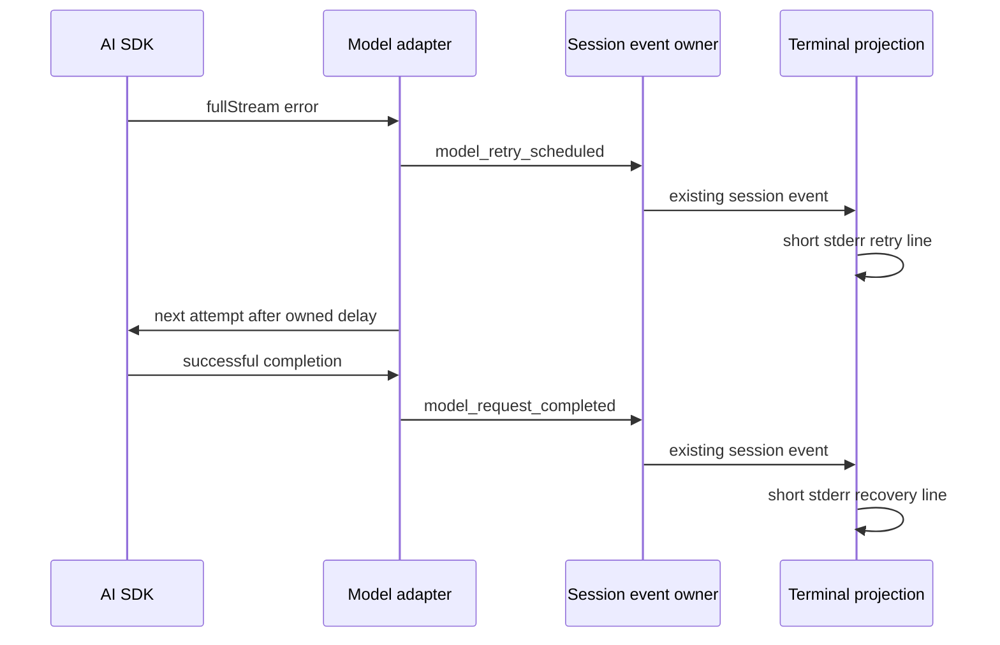

# Provider warning output policy

## 背景

Headless `--prompt` 的 stdout 是用户或脚本消费的模型回答，stderr 只应承载 ZCode 自己能解释、能行动的错误。Node runtime、provider SDK、AI SDK 的兼容性 warning 属于依赖层诊断：它们可以进入受控调试日志或测试断言，但不应直接污染普通 `--prompt` 输出。

## 输出契约

- `--prompt` 正常成功时，stdout 只输出最终回答或 `--json` payload。
- 普通 stderr 保留 ZCode 格式化后的本地错误、provider 业务错误、取消、权限拒绝和 verbose 栈信息。
- 已知且不可操作的依赖层 warning 在 CLI 入口统一过滤，包括 Node TLS 环境 warning、Node/loader 已知 warning、AI SDK Anthropic 兼容 thinking budget warning。
- 过滤必须是精确匹配或窄匹配，不能吞掉未知 stderr、provider 错误正文、权限提示或用户命令输出。
- 能从源头避免 warning 的 model/provider option，优先在能力策略中补齐。例如 Anthropic 兼容 thinking mode 必须显式声明 `budgetTokens`，避免 AI SDK 使用隐式默认值。

## Model retry output

The model adapter owns error classification, retry admission, and retry timing.
The CLI projects existing session events into terminal status lines.
The AI SDK error callback must not print raw errors or consume the stream error.
The adapter must still receive the error through `fullStream` and preserve its structured diagnostics.

Plain text prompt mode writes one short line to stderr when a retry is scheduled.
The line shows the retry number, retry limit, delay, and safe HTTP status or classified reason.
It never includes raw error objects, headers, cookies, request bodies, or provider message text.
Starting another attempt does not indicate recovery.
A successful request after a reported retry writes one short recovery line.
Final failures still use the existing CLI error and nonzero exit code.
JSON and stream-json modes keep their existing output contracts without terminal retry lines.

The provider catalog refresh keeps using the bundled or active configuration when no remote release is advertised.
The normal CLI output must not describe this optional result as `ZCode Built-in missing`.
Non-actionable refresh results stay silent; actual refresh failures remain visible.

These changes affect terminal presentation only.
The desktop continuous stream and mobile replayable stream keep their existing events and ownership.

## 测试覆盖

- Real AI SDK regression tests cover HTTP 502 recovery and exhausted retries without raw stderr errors.
- CLI tests cover live retry output, stable call correlation, frozen queue probes, and duplicate completion events.
- CLI tests keep JSON output unchanged and optional catalog refresh results silent in all runtime modes.
- CLI warning interceptor 覆盖 Node TLS warning 和 AI SDK Anthropic thinking budget warning，并证明未知 stderr 原样保留。
- Anthropic 兼容 thinking toggle 的 capability/default policy 覆盖 `budgetTokens`，确保 GLM/DeepSeek Anthropic 兼容模式不会依赖 AI SDK 隐式默认 budget。
